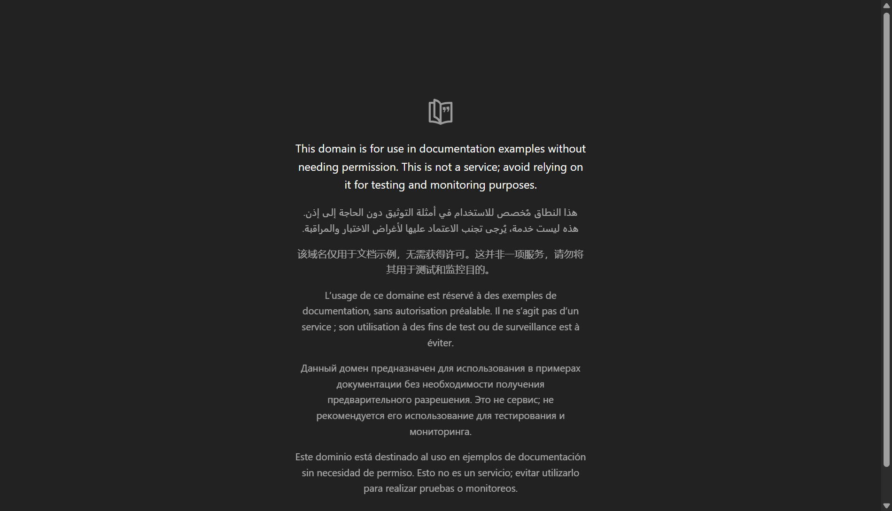

# Teardown · example.com

**Verdict**: A minimal static placeholder with no functional complexity.

**The answer**
The site is a static informational page with no backend logic, no third-party dependencies, and no complex frontend architecture.

**The stack**
*   **3D engine**: None found (Evidence: `found=False`)
*   **Animation**: None found (Evidence: `found=False`)
*   **Smooth scroll**: None found (Evidence: `found=False`)
*   **Visual effects**: None found (Evidence: `found=False`)
*   **Compression**: None found (Evidence: `found=False`)
*   **Build tools**: None found (Evidence: `found=False`)

**How the effect works**
1.  The browser requests the main HTML document from the root path.
2.  The browser parses the HTML and identifies a single script tag pointing to a local file.
3.  The browser downloads the 1,679-byte script file.
4.  The script executes, but no external libraries or complex logic are triggered.
5.  The page renders the static content "Example Domain".
6.  The user scrolls slightly, triggering 16 wheel events, but no custom scroll effects are observed.

**What it loads**
*   1 Script file: `s.js` (1,679 bytes) from `example.com`
*   No images, fonts, or other assets are reported in the asset totals.

**Rebuild it**
1.  Create a single HTML file with the title "Example Domain".
2.  Add a simple paragraph with the text "This domain is for use in illustrative examples in documents."
3.  Add a link to the IANA website with the text "More information..."
4.  Create a small JavaScript file `s.js` with minimal or no code (since no specific logic was detected).
5.  Link the `s.js` file in the HTML head or body.
6.  Serve the files over HTTPS.
7.  Ensure no external CSS or JavaScript libraries are included.

**What the evidence can't show**
*   The content of the `s.js` file, as no code signals or library banners were captured.
*   Whether the script performs any hidden actions, as no specific behavior was observed beyond the page load.
*   The exact HTML structure, as only the title and general content were inferred from the snapshot and metadata.

## Evidence

- Snapshot:   (REA captured, Jarvis decoded)
- Stack (Jarvis reading REA's captured code):
- none identified
- Assets: 1 files, 1,679 bytes (Jarvis browser read)
- Origins: example.com (Jarvis browser read)
- REA evidence ids: ev_ee1d31fbe5c7e2911fe833ce84d4515b8044a84d1b471e1bebe262c82e7695eb, ev_b41f02c5d468a49c52d64601ae9bc52366898a08d8f4b4755c4fa2e140cd94fd
- Attribution: REA lines were captured by REA; Jarvis lines were read from the owned browser or REA's code.
- Limits: REA attaches to an already-running page; library names come from banners and strings, not a package manifest.

[[REA]] · [[Jarvis]]

