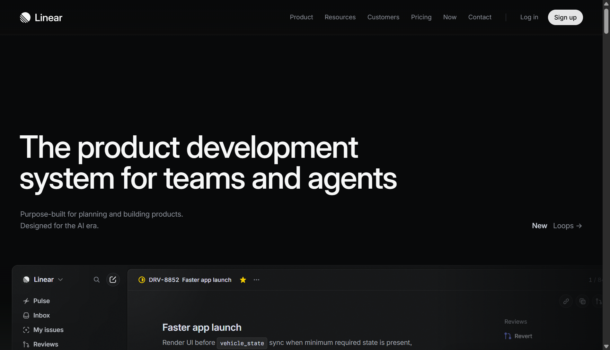

# Teardown · linear.app

**Verdict:** A highly optimized, component-heavy Next.js marketing site.

**The answer**
Linear uses Next.js for its frontend, serving assets from a static CDN. The architecture prioritizes fast initial load times through extensive code-splitting.

**The stack**
*   **Framework:** Next.js (Evidence: Script paths contain `_next/static/chunks` [Jarvis])
*   **Hosting/CDN:** static.linear.app (Evidence: All script URLs point to this subdomain [Jarvis])
*   **Browser:** Chrome/158.0.8127.37 (Evidence: Browser metadata [Jarvis])
*   **Language:** JavaScript (Evidence: All assets are `.js` files [Jarvis])

**How the effect works**
1.  The browser requests the main HTML document from linear.app.
2.  The HTML references numerous JavaScript chunks hosted on static.linear.app.
3.  The browser downloads these chunks in parallel from the CDN.
4.  The JavaScript bundles hydrate the React/Next.js components on the client side.
5.  The page renders the long-form content (scroll depth ~8916px) dynamically.

**What it loads**
*   Over 100 distinct JavaScript chunk files (e.g., `DU7eR8IP.js`, `DtTBBxMa.js`, etc.) [Jarvis]
*   No CSS or image files were explicitly listed in the provided evidence, though they are likely present in the full network log.
*   The page title: "Linear – The system for product development" [REA]

**Rebuild it**
1.  Initialize a Next.js project with `create-next-app`.
2.  Configure the build to output static assets to a CDN-compatible structure (mimicking `_next/static/chunks`).
3.  Implement aggressive code-splitting using dynamic imports for each section of the landing page.
4.  Set up a static CDN (like Cloudflare or AWS S3+CloudFront) to serve the `static` assets.
5.  Create a long-form landing page component with multiple sections to match the ~8900px scroll depth.
6.  Optimize the initial bundle size to ensure sub-second load times on fast connections.
7.  Deploy the application and verify that all assets are served from the static subdomain.

**What the evidence can't show**
*   The specific React components or UI library used (e.g., Tailwind, Chakra).
*   The backend API structure or database technology.
*   The exact content of the JavaScript chunks (only filenames are provided).
*   Whether the site uses Server-Side Rendering (SSR) or Static Site Generation (SSG) for the initial HTML, though the fast load time suggests SSG or highly cached SSR.
*   Any third-party analytics or tracking scripts, as only internal static assets are listed.

## Evidence

- Snapshot:   (REA captured, Jarvis decoded)
- Stack (Jarvis reading REA's captured code):
- Build tools: vite (Jarvis reading REA's code)
- Assets: 250 files, 197,384 bytes (Jarvis browser read)
- Origins: api.linear.app, e.linear.app, linear.app, static.linear.app, webassets.linear.app (Jarvis browser read)
- REA evidence ids: ev_f9989df0264ae753e72a9df4e635b6b00b331b893ea0652a0936d1502c6982ac, ev_358eebe31d1429ac35885e15ec92c3e686533f56ad909ffc8aad5fd0a439bf15
- Attribution: REA lines were captured by REA; Jarvis lines were read from the owned browser or REA's code.
- Limits: REA attaches to an already-running page; library names come from banners and strings, not a package manifest.

[[REA]] · [[Jarvis]]

