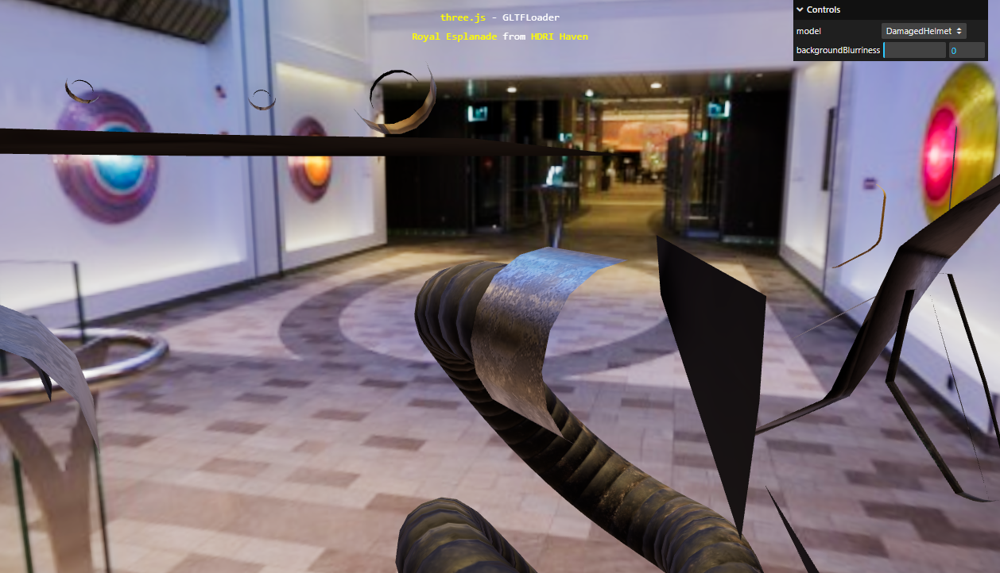

# Teardown · threejs.org

**Verdict:** A standard, unminified Three.js example page demonstrating glTF loading with HDR lighting.

**The answer**
The page is a WebGL demo that loads a glTF model and applies an HDR environment map for realistic lighting.

**The stack**
*   **3D Engine:** Three.js (r187) - *Evidence: Licence banner and `REVISION` constant in `three.core.js`.*
*   **Compression:** DRACOLoader - *Evidence: String found in captured code.*
*   **Controls:** OrbitControls - *Evidence: Script load and REA dependency graph.*
*   **GUI:** lil-gui - *Evidence: Script load.*

**How the effect works**
1.  The browser loads the Three.js core and module scripts.
2.  `GLTFLoader` is initialized to fetch the model definition from `raw.githubusercontent.com`.
3.  `UltraHDRLoader` fetches the `royal_esplanade_2k.hdr.jpg` file.
4.  The HDR file is processed into an environment map.
5.  The environment map is assigned to the scene's background and used for image-based lighting (IBL) on the model.
6.  `OrbitControls` attaches to the camera, allowing user interaction.
7.  The render loop updates the camera and renders the scene to the canvas.

**What it loads**
*   **Scripts:** `three.core.js` (298 KB), `three.module.js` (132 KB), `GLTFLoader.js` (27 KB), and other utilities.
*   **Textures:** `royal_esplanade_2k.hdr.jpg` (552 KB).
*   **Models:** A glTF model fetched from GitHub (size not captured in asset totals, likely small or streamed).

**Rebuild it**
1.  Initialize a Three.js scene, camera, and WebGL renderer.
2.  Create a `GLTFLoader` instance.
3.  Load a glTF model file (e.g., from a local path or CDN).
4.  Create an `UltraHDRLoader` or `RGBELoader` instance.
5.  Load an HDR environment map file.
6.  Set the loaded environment map as the `scene.environment` and `scene.background`.
7.  Add `OrbitControls` to the camera and start the animation loop.

**What the evidence can't show**
*   The specific glTF model file size and content (only the index JSON was logged).
*   The exact shader code used for the model (only generic shader signals like `fragmentShader` were counted).
*   Whether the model is animated (no animation library found, but glTF can contain animations).

## Evidence

- Snapshot:   (REA captured, Jarvis decoded)
- Stack (Jarvis reading REA's captured code):
- 3D engine: r187 (Jarvis reading REA's code)
- Compression: DRACOLoader (Jarvis reading REA's code)
- Assets: 13 files, 1,051,259 bytes (Jarvis browser read)
- Origins: raw.githubusercontent.com, threejs.org (Jarvis browser read)
- REA evidence ids: ev_6d75182a266101e8189ef5bae1058d9f09a131019be9c1594f1bb04b2f2ba53b, ev_c68c5a00168d8388be140f327eef5d0492f7d4aabfe4847e03b308ce00946ff8
- Attribution: REA lines were captured by REA; Jarvis lines were read from the owned browser or REA's code.
- Limits: REA attaches to an already-running page; library names come from banners and strings, not a package manifest.

[[REA]] · [[Jarvis]]

